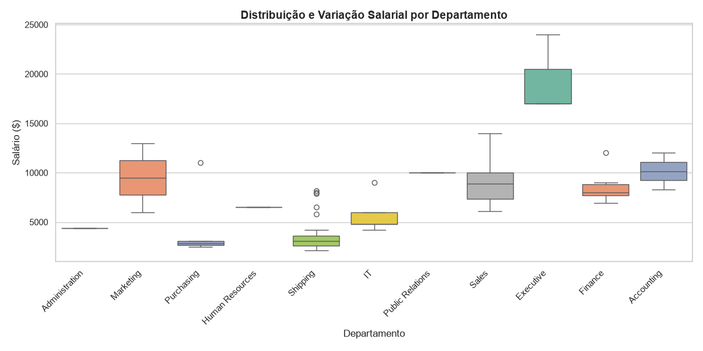
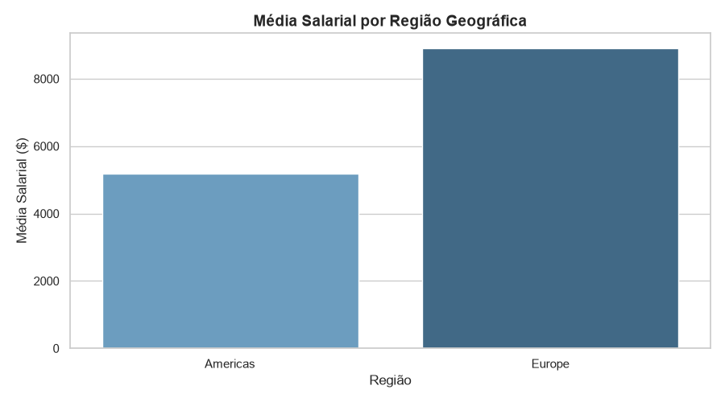

# 📊 BI & Análise de Dados de RH (HR FreeSQL)

Olá! Este repositório contém a resolucao do \*\*Projeto

- Módulo 1 (Semana 13)\*\*.

---

## 👨‍💻 Cabeçalho do Projeto

- **Aluno:** Maicon
- **Turma:** Business V3 (Ciclo 2)
- **Atividade:** Projeto Avaliativo - Módulo 1 (Semana 13)
- **🎥 Vídeo da Apresentação:** (https://drive.google.com/file/d/1nZIzPstRGvvQ_H0GZa9y-g1zW-0IETys/view?usp=sharing)

> **Nota:** Optei por utilizar o VS Code (Visual Studio Code) para o desenvolvimento de todo o projeto (escrita das consultas SQL, execução do script Python e edição da documentação Markdown), por ser o meu ambiente de desenvolvimento principal e que já utilizo há anos.

---

## 🚀 O que é este projeto?

O objetivo foi analisar como a empresa distribui os salários entre cargos, departamentos e regiões geográficas do mundo.

A análise busca responder perguntas como:

- Quais departamentos possuem as maiores e menores remunerações?
- Como os salários mudam de acordo com o país ou região?
- Existem salários muito discrepantes puxando a média para cima em relação à mediana?

---

## 🗃️ De onde vêm os dados?

Utilizamos o esquema **HR** no banco **FreeSQL**. As tabelas envolvidas foram:

- `EMPLOYEES`: Dados dos funcionários (ID, nome, salário, departamento, cargo).
- `DEPARTMENTS`: Informações sobre os departamentos e respetiva localização.
- `JOBS`: Cargos e faixas salariais.
- `LOCATIONS`, `COUNTRIES` & `REGIONS`: Dados de localização geográfica (cidades, estados, países e regiões).

---

## 🛠️ O que foi feito

### 1. Extração dos Dados (SQL)

Escrevemos duas consultas SQL no FreeSQL para extrair os ficheiros CSV:

- **`query_1.sql`**: Relaciona funcionários, departamentos e cargos utilizando `LEFT JOIN` e aplica o filtro `WHERE e.department_id IS NOT NULL` para eliminar registos sem departamento. Exportado como **`query_01.csv`**.
- **`query_2.sql`**: Relaciona funcionários com departamentos, localizações, países e regiões usando `LEFT JOIN`, aplicando o filtro `WHERE r.region_name IS NOT NULL`. Exportado como **`query_02.csv`**.

### 2. Análise e Gráficos (Python)

Utilizando o script `analise.py` com as bibliotecas `pandas`, `matplotlib` e `seaborn`:

- Calculamos as medidas estatísticas básicas (média, mediana, salário mínimo e máximo).
- Geramos o gráfico **`boxplot_salarios_dept.png`** para analisar a variação e distribuição salarial por departamento.
- Geramos o gráfico **`media_salario_regiao.png`** para comparar as médias salariais entre as regiões.

---

## 📸 Resultados e Visualizações

### 📌 Salários por Departamento



### 📌 Média Salarial por Região



---

## 🧠 Principais Insights & Limitações

- **Média vs. Mediana:** A média salarial geral ficou acima da mediana. Isso indica uma assimetria positiva provocada por cargos executivos/gerenciais com salários altos que puxam a média para cima.
- **Departamentos:** Setores como _Executive_ e _IT_ apresentam faixas salariais significativamente superiores em relação aos setores operacionais.
- **Distribuição Geográfica:** A maior parte do contingente de funcionários e da folha salarial concentra-se nas regiões das _Americas_ e _Europe_.
- **⚠️ Limitação:** Esta análise não considera fatores macroeconómicos locais, tais como custo de vida, impostos e taxa de inflação de cada país. Portanto, um salário nominal maior numa região não garante necessariamente um poder de compra real superior.

---

## 💻 Como rodar na sua máquina

1. **Clone o repositório:**
   ```bash
   git clone [https://github.com/smaicon/projeto-hr-bi-analise.git](https://github.com/smaicon/projeto-hr-bi-analise.git)
   cd projeto-hr-bi-analise
   ```
